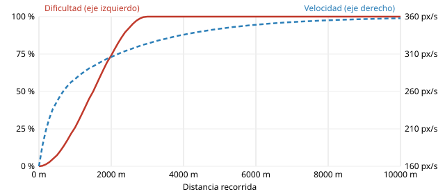

# Métricas y curva de dificultad

Las medidas del recorrido (GDD-06) y cómo crece la dificultad (GDD-08). Salen del propio código: `MetricsReportTest` las
mide con el salto del juego y las deja en `shared/build/metricas/`, así que si cambia un ajuste de
`files/ajustes.json` se vuelven a sacar y se copian aquí. Son los valores iniciales, para afinar jugando (PLY-15).
Unidades: 1 tile = 16 px = 1 m.

## El salto

El detalle está en [movimiento](movimiento.md). Los extremos:

- **El más bajo**, un toque rápido (0,05 s): 24 px de alto (1,5 tiles) y 2,6 tiles de largo a 120 px/s.
- **El más alto**, con el dedo apoyado 0,37 s o más: 67 px (4,2 tiles) y 0,75 s en el aire, 5,6 tiles de largo a
  120 px/s y 9,4 a 200 px/s.

## Los barrancos

| Distancia | Velocidad | Dificultad | Pide el generador | Justo: igual / +2 / −3 | Posible: igual / +2 / −3 |
|---|---|---|---|---|---|
| 0 m | 120 px/s | 0 % | 2 tiles | 4 / 3 / 5 | 4 / 3 / 5 |
| 300 m | 158 px/s | 2 % | 3 tiles | 5 / 4 / 7 | 6 / 5 / 7 |
| 600 m | 178 px/s | 10 % | 4 tiles | 6 / 5 / 8 | 7 / 5 / 8 |
| 900 m | 189 px/s | 21 % | 4 tiles | 7 / 5 / 9 | 7 / 6 / 9 |
| 1200 m | 194 px/s | 35 % | 5 tiles | 7 / 6 / 9 | 7 / 6 / 9 |
| 1800 m | 198 px/s | 64 % | 5 tiles | 7 / 6 / 9 | 7 / 6 / 10 |
| 2400 m | 199 px/s | 89 % | 6 tiles | 7 / 6 / 9 | 8 / 6 / 10 |
| 3600 m | 199 px/s | 100 % | 7 tiles | 7 / 6 / 9 | 8 / 6 / 10 |
| 5000 m | 199 px/s | 100 % | 7 tiles | 7 / 6 / 9 | 8 / 6 / 10 |

- **Pide el generador**: el barranco más ancho que puede salir a esa distancia; cada barranco se sortea entre 2 tiles y
  ese.
- **Justo**: el más ancho que pasa la regla del validador (3 momentos de despegue con 4 pulsaciones buenas cada uno,
  [generación](generacion.md)), al mismo nivel, con el suelo de enfrente 2 tiles más alto o 3 más bajo.
- **Posible**: el más ancho que se cruza con algún salto, aunque sea perfecto. Más allá, imposible.

Así que un barranco **fácil** es el de 2 tiles del principio, con 2 tiles de holgura sobre lo justo; uno **difícil**, el
de 7 tiles a toda velocidad, justo en el límite: 0,56 s de carrera, dentro de los 0,55 a 0,6 s que recomienda la guía 1
de GameMaster. Uno **imposible** es el que pasa de «Posible», y el generador no lo pide nunca (la prueba lo comprueba en
cada fila). Subiendo 2 tiles el límite justo baja a 6: el validador descarta esas combinaciones y se genera otra pieza.

## Las alturas de los recolectables

| Dónde | Altura del centro sobre el suelo de despegue | Qué pide |
|---|---|---|
| En el suelo: fila u obstáculo | 8 px | La fila se recoge corriendo; el obstáculo se salva con cualquier salto que pase por encima |
| Techo sobre un barranco | 74 px | Lo toca un salto que suba más de 48 px por debajo (el dedo apoyado más de unos 0,2 s): pide uno más corto |
| Arco sobre un barranco | Sobre la trayectoria de un salto medio que cruza | Recogerlo es medir bien el salto |
| Elección | En lo alto de un salto largo sobre el obstáculo, por encima de 54 px | Un toque rápido (la cabeza llega a 44 px) pasa por debajo; manteniendo el dedo se recoge |

## La curva de dificultad

| Distancia | Tiempo de juego | Velocidad | Dificultad | Barranco más ancho | Restan cada 100 m: objetivo · medido |
|---|---|---|---|---|---|
| 0 a 500 m | Hasta 0,9 min | 120 a 174 px/s | 0 a 7 % | 2 a 3 tiles | 2,0 a 2,4 · 1,7 |
| 500 a 1000 m | 0,9 a 1,6 min | 174 a 191 px/s | 7 a 26 % | 3 a 4 tiles | 2,4 a 3,6 · 2,3 |
| 1000 a 2000 m | 1,6 a 3 min | 191 a 199 px/s | 26 a 74 % | 4 a 6 tiles | 3,6 a 6,4 · 3,4 |
| 2000 a 3500 m | 3 a 5 min | 199 a 200 px/s | 74 a 100 % | 6 a 7 tiles | 6,4 a 8 · 4,1 |
| Más de 3500 m | Desde 5 min | 200 px/s | 100 % | 7 tiles | 8 · 3,7 |

- **La velocidad** sube deprisa al principio y cada vez más despacio: a los 90 s va por el 87 % del camino y a los
  120 s por el 94 % ([movimiento](movimiento.md)).
- **La dificultad** va más despacio, una curva en S de la distancia: casi plana el primer minuto, en el que los barrancos
  no pasan de 3 tiles (la guía 1 pide que perder en el primer minuto sea casi imposible), y al máximo a los 3000 m, a los
  4,3 minutos.
- **Los barrancos** piden del 45 % al 75 % del salto largo a la velocidad del momento.
- **Lo que resta** busca de 2 a 8 cada 100 m en los tramos de tensión, como mucho dos por pieza. Lo medido en 20 partidas
  de 5 km se queda en 1,7 a 4,1 de media, porque las calmas no llevan ninguno y el validador quita los que no se pueden
  esquivar con margen. Lo que suma se mantiene en unos 18 cada 100 m ([recolectables](recolectables.md)).
- **Tensión y calma** se turnan: tras 150 a 250 m de tensión vienen de 3 a 8 piezas tranquilas, unos 10 s, con perritos
  y gatitos y sin nada que reste. La partida empieza con 30 tiles llanos y una fila de perritos.

Desde los 4,3 minutos la dificultad ya no sube: lo que mantiene el interés es el ritmo de tensión y calma, la variedad
del recorrido y, en M4, la música.
Si jugando se hace corto o largo, se ajusta en `files/ajustes.json` (`difficultyRampMeters`, `speedRampMeters`).
