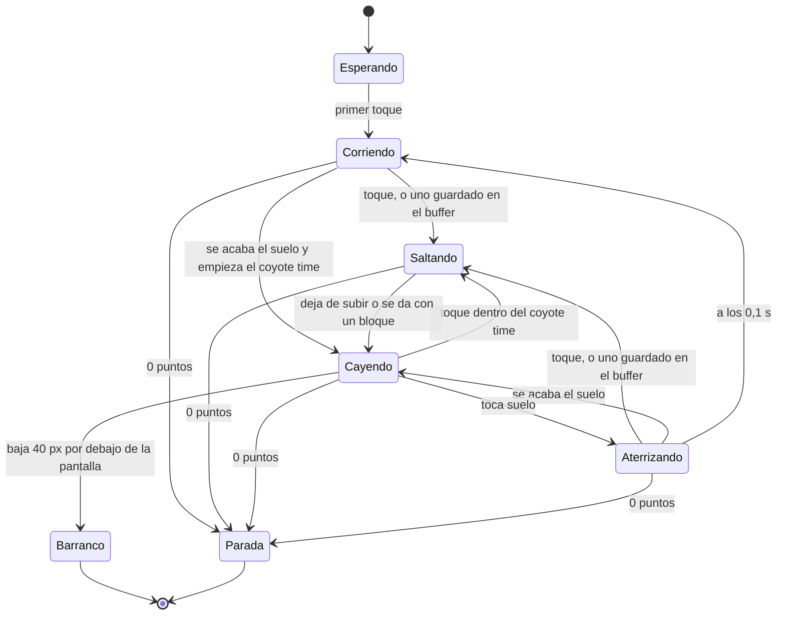

# Movimiento de Caro

La tabla de parámetros del salto y la carrera (GDD-05), lista para programar. Las unidades son píxeles del juego
(1 tile = 16 px = 1 m) y segundos. Son los valores iniciales: se ajustan jugando (PLY-15) y vivirán en datos (TEC-07).

## Parámetros

| Parámetro | Valor | Nota |
|---|---|---|
| Paso de la física | 1/60 s | Con interpolación para pantallas de 90 y 120 Hz (TEC-05) |
| Velocidad al empezar | 160 px/s (10 m/s) | A 120, Fangusk la encontró lenta: «se hace lento, parece un paseo» |
| Velocidad máxima | 360 px/s (22,5 m/s) | Se acerca sin llegar; a tope deja 0,6 s para reaccionar en la pantalla más estrecha, como el dinosaurio de Chrome |
| Subida de la velocidad | `v(d) = 160 + 80 · (1 − e^(−d / 300 m)) + 120 · (1 − e^(−d / 2500 m))` | Sube durante toda la partida, como pidió Fangusk ([ADR 0007](adr/0007-la-dificultad-velocidad-y-obstaculos-en-el-aire.md)): deprisa al principio y cada vez más despacio. 247 px/s a los 500 m (35 s), 277 al kilómetro (1 min), 306 a los 2 km (2 min) y 344 a los 5 km (4,5 min); con la dificultad, en [métricas](metricas.md) |
| Impulso del salto | 230 px/s hacia arriba | Al apoyar el dedo, sin esperar a levantarlo |
| Gravedad con el dedo apoyado | 300 px/s² | Mientras sube y como mucho durante la ventana de pulsación |
| Ventana de pulsación | 0,36 s | Mantener más no salta más |
| Gravedad normal | 1600 px/s² | Al soltar, al llegar arriba y al caer |
| Velocidad máxima de caída | 300 px/s | 5 px por fotograma |
| Coyote time | 0,08 s (5 fotogramas) | Se puede saltar justo después de dejar el borde |
| Buffer de salto | 0,1 s (6 fotogramas) | Un toque justo antes de aterrizar salta al aterrizar |
| Caja de colisión de Caro | 10 × 20 px | Provisional, menor que el sprite y a su favor (CHR-08) |
| Caja de los recolectables | 16 × 16 px lo que suma, 10 × 10 lo que resta | Generosa y estricta, a favor de ella (guía 1 de GameMaster); el dibujo es de 12 × 12 en el prototipo |
| Primer toque de la partida | Arranca la carrera | No salta ([ADR 0002](adr/0002-salto-por-tiempo-de-pulsacion.md)) |

## El salto según el tiempo de pulsación

Simulado con la misma lógica que el juego (60 pasos por segundo, el dedo cuenta por pasos), despegando y aterrizando a la
misma altura. Un toque normal en una pantalla dura entre 0,05 y 0,1 s.

| Dedo apoyado | Altura | Tiempo en el aire | Longitud a 160 px/s | A 240 px/s | A 360 px/s |
|---|---|---|---|---|---|
| 3 pasos, 0,05 s (toque rápido) | 24 px (1,5 tiles) | 0,35 s | 56 px (3,5 tiles) | 84 px | 126 px |
| 5 pasos, 0,08 s | 29 px (1,8 tiles) | 0,40 s | 64 px (4,0 tiles) | 96 px | 144 px |
| 7 pasos, 0,12 s | 35 px (2,2 tiles) | 0,45 s | 72 px (4,5 tiles) | 108 px | 162 px |
| 10 pasos, 0,17 s | 42 px (2,7 tiles) | 0,52 s | 83 px (5,2 tiles) | 125 px | 187 px |
| 12 pasos, 0,20 s | 47 px (3,0 tiles) | 0,55 s | 88 px (5,5 tiles) | 132 px | 198 px |
| 15 pasos, 0,25 s | 54 px (3,4 tiles) | 0,62 s | 99 px (6,2 tiles) | 149 px | 223 px |
| 18 pasos, 0,30 s | 60 px (3,7 tiles) | 0,68 s | 109 px (6,8 tiles) | 163 px | 245 px |
| 22 pasos o más, 0,37 s (pulsación larga) | 67 px (4,2 tiles) | 0,75 s | 120 px (7,5 tiles) | 180 px | 270 px (16,9 tiles) |

La ventana de pulsación de 0,36 s deja que cuenten 22 pasos: con el vigésimo segundo, el dedo lleva 0,367 s. `CaroTest`
comprueba que el juego salta exactamente esto.

Lo que sale de aquí para diseñar el recorrido (medido a cada velocidad en [métricas](metricas.md)):

- El barranco más ancho que se puede cruzar es la longitud de la pulsación larga a la velocidad del momento; el generador
  solo usa una parte de ella, con margen ([generación](generacion.md)).
- Subir de un suelo a otro más alto al otro lado de un barranco cuesta altura: el salto largo sube 4,2 tiles, así que los
  desniveles de subida se quedan en 2 tiles.
- Con la velocidad, la misma pulsación salta más lejos: la dificultad viene de la velocidad, no de cambiar el salto.

## La cámara

La sigue a ella (PLY-13), sin adelantarse ni suavizarse, porque su movimiento ya es suave:

- **En horizontal**, Caro va siempre a 96 px del borde izquierdo, entre el 21 % y el 30 % de la pantalla según su ancho.
  A 360 px/s se ven por delante entre 0,6 y 1 s de recorrido, según el ancho: lo mismo que deja el dinosaurio de Chrome a
  toda velocidad.
- **En vertical**, una zona muerta del alto de la pantalla: mientras corre por el suelo la cámara no se mueve (el suelo
  más alto, a 6 tiles, cabe con margen) y solo sube cuando su cabeza llegaría a 8 px del borde de arriba. Pasa en el salto
  más alto desde los suelos más altos, en las pantallas de 180 px de alto.
- **Sin temblores**: la cámara y Caro se redondean igual al píxel del juego, así que mientras la cámara sube con ella,
  Caro se queda quieta en la pantalla y es el mundo el que baja.

## Los estados de Caro

La máquina de estados de `Caro` (PLY-09). Los dos últimos acaban la partida y de ellos no se sale.

En el código: `Waiting` (esperando), `Running` (corriendo), `Jumping` (saltando), `Falling` (cayendo), `Landing`
(aterrizando), `Fallen` (en el barranco) y `Stopped` (parada). Se salta desde el suelo, al aterrizar y durante el coyote
time; nunca en el aire después. La línea de depuración cuenta los saltos y cuántos vinieron del coyote time y del buffer
(PLY-04).

## Los bloques en el aire

Los bloques sólidos que pidió Fangusk ([ADR 0007](adr/0007-la-dificultad-velocidad-y-obstaculos-en-el-aire.md), PLY-16)
chocan con la caja de colisión de Caro:

- **Desde abajo**, su cabeza no pasa del borde inferior del bloque: deja de subir al momento y empieza a caer, aunque
  mantenga el dedo.
- **De costado**, en el aire, el bloque la frena como una pared y cae pegada a él; si debajo hay un barranco, se acaba
  la partida.
- **Encima**, es suelo: aterriza, corre y al acabar el bloque cae con su coyote time, como desde cualquier borde.
- **A su favor**: si al subir solo roza con 3 px o menos la esquina de atrás de un bloque que ya deja atrás, no la frena
  (PLY-05); y si sus pies llegan al costado a 4 px o menos de la parte de arriba, se sube encima en vez de chocar.

## Las plataformas

Las plataformas que pidió Fangusk tras la beta 4 son semisólidas, como en Mario
([ADR 0009](adr/0009-mas-plataformeo-plataformas-semisolidas-y-moviles.md), PLY-17):

- **Desde abajo y de costado** no la frenan: el salto la atraviesa y la carrera pasa por debajo.
- **Encima**, cuando cae sobre ella con los pies a 4 px o menos por encima de su cara, aterriza y corre como sobre el
  suelo; al acabar la plataforma cae con su coyote time.
- **Las móviles** (ITM-20) van y vienen de lado o de arriba abajo, más despacio en los extremos. Si está encima, la que
  va de lado le suma su velocidad y la que baja la lleva pegada, hasta 2 px por paso, sin que vuelva a aterrizar a cada
  momento. Se mueven con el reloj de la partida, el mismo con el que el validador y el piloto prueban los saltos.

## El retroceso de un huevo o un pescado

Lo pidió Fangusk tras jugar la beta: «que haga un pequeño retroceso parpadeando durante un corto periodo de tiempo (como
hacen otros videojuegos)», y que sea de verdad, aunque la lleve a un barranco. En `files/ajustes.json`:

- **El empujón** (`knockbackSeconds`, 0,3 s; `knockbackSpeed`, 40 px/s): su velocidad de lado pasa de ir hacia atrás a 40
  px/s a su velocidad de carrera a lo largo de esos 0,3 s. En el suelo apenas retrocede un par de píxeles y frena; en el
  aire, el salto se queda corto, así que puede no llegar al otro lado. Hacia atrás la para una pared, como hacia delante.
- **En la pantalla**: la cámara sigue a medias el frenazo, así que se la ve ir hacia atrás unos 15 a 25 px y volver a su
  sitio en un par de décimas.
- **El parpadeo** (`blinkSeconds`, 1 s): se enciende y se apaga 12 veces por segundo, y mientras dura atraviesa los huevos
  y pescados sin perder puntos; a los animales sí los rescata.

## Referencias

Lo que la sesión GameMaster encontró de otros juegos de correr y saltar (sus informes, con las fuentes, en
`../backlog-juego-plataformas/referencias/informes/`). Sirven para calibrar; no se copia nada.

- **Super Mario Run**, la referencia de jugabilidad que eligió Fangusk: no hay cifras publicadas. Un toque da un salto muy
  bajo y mantener el dedo lo sube hasta un máximo; salta solo los obstáculos pequeños; el tutorial enseña junto a Mario un
  medidor que se llena mientras se mantiene el dedo. El salto de Caro sigue la misma idea.
- **El dinosaurio de Chrome**: corre de 360 a 780 px/s en un lienzo de 600 px (de 0,6 a 1,3 pantallas por segundo), con
  3 s sin obstáculos al empezar. Si se suelta el dedo antes de subir 30 px, ignora el corte y da el salto más alto; aquí
  soltar siempre lo baja, y una prueba lo vigila (`aShorterPressNeverJumpsHigher`).
- **Canabalt**: corre de 100 a 800 px/s; mientras se mantiene el dedo sube a velocidad constante como mucho 0,35 s, y un
  toque de menos de 0,08 s da un saltito; respiros de unos 10 s; el primer tramo es fijo y seguro; cada borde tiene 8 px
  invisibles de margen (aquí lo hace el coyote time); y volver a jugar queda bloqueado 0,35 s (aquí, 0,6 s).

Con 200 px/s como tope, Caro iba despacio comparada con ellos: 0,62 pantallas por segundo, lo que el dinosaurio al
empezar. Fangusk lo notó al jugar («parece un paseo») y pidió que la velocidad fuese subiendo: ahora empieza a 160 px/s y
sube durante toda la partida hacia 360, que a tope deja 0,6 s para reaccionar en la pantalla más estrecha, como ellos. Se
cambia en `files/ajustes.json` (`startSpeed`, `quickSpeed`, `maxSpeed` y sus rampas); los barrancos se ajustan solos a la
velocidad.
