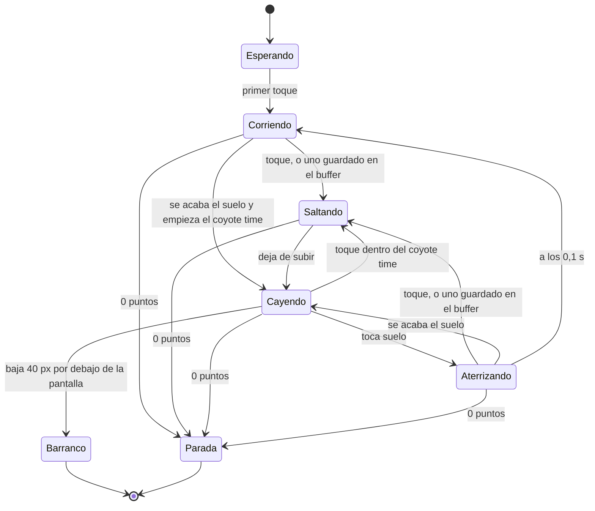

# Movimiento de Caro

La tabla de parámetros del salto y la carrera (GDD-05), lista para programar. Las unidades son píxeles del juego
(1 tile = 16 px = 1 m) y segundos. Son los valores iniciales: se ajustan jugando (PLY-15) y vivirán en datos (TEC-07).

## Parámetros

| Parámetro | Valor | Nota |
|---|---|---|
| Paso de la física | 1/60 s | Con interpolación para pantallas de 90 y 120 Hz (TEC-05) |
| Velocidad al empezar | 120 px/s (7,5 m/s) | Algo menos que correr en Super Mario World |
| Velocidad máxima | 200 px/s (12,5 m/s) | Algo más que su carrera a tope |
| Subida de la velocidad | `v(d) = 200 − 80 · e^(−d / 450 m)` | 179 px/s a 600 m (1 min), 191 a 1000 m y 199 a 2000 m: rápida al principio y cada vez más lenta, cerca del tope entre los 90 y los 120 s, como recomienda la guía 1 de GameMaster; con la dificultad, en [métricas](metricas.md) |
| Impulso del salto | 230 px/s hacia arriba | Al apoyar el dedo, sin esperar a levantarlo |
| Gravedad con el dedo apoyado | 300 px/s² | Mientras sube y como mucho durante la ventana de pulsación |
| Ventana de pulsación | 0,36 s | Mantener más no salta más |
| Gravedad normal | 1600 px/s² | Al soltar, al llegar arriba y al caer |
| Velocidad máxima de caída | 300 px/s | 5 px por fotograma |
| Coyote time | 0,08 s (5 fotogramas) | Se puede saltar justo después de dejar el borde |
| Buffer de salto | 0,1 s (6 fotogramas) | Un toque justo antes de aterrizar salta al aterrizar |
| Caja de colisión de Caro | 10 × 20 px | Provisional, menor que el sprite y a su favor (CHR-08) |
| Caja de los recolectables | 12 × 12 px | Provisional |
| Primer toque de la partida | Arranca la carrera | No salta ([ADR 0002](adr/0002-salto-por-tiempo-de-pulsacion.md)) |

## El salto según el tiempo de pulsación

Simulado con la misma lógica que el juego (60 pasos por segundo, el dedo cuenta por pasos), despegando y aterrizando a la
misma altura. Un toque normal en una pantalla dura entre 0,05 y 0,1 s.

| Dedo apoyado | Altura | Tiempo en el aire | Longitud a 120 px/s | A 160 px/s | A 200 px/s |
|---|---|---|---|---|---|
| 3 pasos, 0,05 s (toque rápido) | 24 px (1,5 tiles) | 0,35 s | 42 px (2,6 tiles) | 56 px | 70 px |
| 5 pasos, 0,08 s | 29 px (1,8 tiles) | 0,40 s | 48 px (3,0 tiles) | 64 px | 80 px |
| 7 pasos, 0,12 s | 35 px (2,2 tiles) | 0,45 s | 54 px (3,4 tiles) | 72 px | 90 px |
| 10 pasos, 0,17 s | 42 px (2,7 tiles) | 0,52 s | 62 px (3,9 tiles) | 83 px | 103 px |
| 12 pasos, 0,20 s | 47 px (3,0 tiles) | 0,55 s | 66 px (4,1 tiles) | 88 px | 110 px |
| 15 pasos, 0,25 s | 54 px (3,4 tiles) | 0,62 s | 74 px (4,6 tiles) | 99 px | 123 px |
| 18 pasos, 0,30 s | 60 px (3,7 tiles) | 0,68 s | 82 px (5,1 tiles) | 109 px | 137 px |
| 22 pasos o más, 0,37 s (pulsación larga) | 67 px (4,2 tiles) | 0,75 s | 90 px (5,6 tiles) | 120 px | 150 px (9,4 tiles) |

La ventana de pulsación de 0,36 s deja que cuenten 22 pasos: con el vigésimo segundo, el dedo lleva 0,367 s. `CaroTest`
comprueba que el juego salta exactamente esto.

Lo que sale de aquí para diseñar el recorrido (medido a cada velocidad en [métricas](metricas.md)):

- El barranco más ancho que se puede cruzar es la longitud de la pulsación larga a la velocidad del momento; el generador
  solo usa una parte de ella, con margen ([generación](generacion.md)).
- Subir de un suelo a otro más alto al otro lado de un barranco cuesta altura: el salto largo sube 4,2 tiles, así que los
  desniveles de subida se quedan en 2 tiles.
- Con la velocidad, la misma pulsación salta más lejos: la dificultad viene de la velocidad, no de cambiar el salto.

## La cámara

La sigue a ella (PLY-13), sin adelantarse ni suavizarse, porque su movimiento ya es suave:

- **En horizontal**, Caro va siempre a 96 px del borde izquierdo, entre el 21 % y el 30 % de la pantalla según su ancho.
  A toda velocidad se ven por delante entre 1,1 y 1,7 s de recorrido, así que no hace falta abrir más la vista con la
  velocidad.
- **En vertical**, una zona muerta del alto de la pantalla: mientras corre por el suelo la cámara no se mueve (el suelo
  más alto, a 6 tiles, cabe con margen) y solo sube cuando su cabeza llegaría a 8 px del borde de arriba. Pasa en el salto
  más alto desde los suelos más altos, en las pantallas de 180 px de alto.
- **Sin temblores**: la cámara y Caro se redondean igual al píxel del juego, así que mientras la cámara sube con ella,
  Caro se queda quieta en la pantalla y es el mundo el que baja.

## Los estados de Caro

La máquina de estados de `Caro` (PLY-09). Los dos últimos acaban la partida y de ellos no se sale.

En el código: `Waiting` (esperando), `Running` (corriendo), `Jumping` (saltando), `Falling` (cayendo), `Landing`
(aterrizando), `Fallen` (en el barranco) y `Stopped` (parada). Se salta desde el suelo, al aterrizar y durante el coyote
time; nunca en el aire después. La línea de depuración cuenta los saltos y cuántos vinieron del coyote time y del buffer
(PLY-04).

## Referencias

Lo que la sesión GameMaster encontró de otros juegos de correr y saltar (sus informes, con las fuentes, en
`../backlog-juego-plataformas/referencias/informes/`). Sirven para calibrar; no se copia nada.

- **Super Mario Run**, la referencia de jugabilidad que eligió Fangusk: no hay cifras publicadas. Un toque da un salto muy
  bajo y mantener el dedo lo sube hasta un máximo; salta solo los obstáculos pequeños; el tutorial enseña junto a Mario un
  medidor que se llena mientras se mantiene el dedo. El salto de Caro sigue la misma idea.
- **El dinosaurio de Chrome**: corre de 360 a 780 px/s en un lienzo de 600 px (de 0,6 a 1,3 pantallas por segundo), con
  3 s sin obstáculos al empezar. Si se suelta el dedo antes de subir 30 px, ignora el corte y da el salto más alto; aquí
  soltar siempre lo baja, y una prueba lo vigila (`aShorterPressNeverJumpsHigher`).
- **Canabalt**: corre de 100 a 800 px/s; mientras se mantiene el dedo sube a velocidad constante como mucho 0,35 s, y un
  toque de menos de 0,08 s da un saltito; respiros de unos 10 s; el primer tramo es fijo y seguro; cada borde tiene 8 px
  invisibles de margen (aquí lo hace el coyote time); y volver a jugar queda bloqueado 0,35 s (aquí, 0,6 s).

Comparado con ellos, Caro va despacio: a tope recorre 0,62 pantallas por segundo, lo que el dinosaurio al empezar, y deja
más de 1 s para reaccionar, cuando ellos dejan 0,6. Es cómodo para disfrutar; si Fangusk quiere más reto en las partidas
largas, GameMaster propone subir la velocidad máxima a 280–320 px/s, que deja aún unos 0,7 s. Es una decisión suya, y se
cambia en `files/ajustes.json` (`maxSpeed`): los barrancos se ajustan solos a la velocidad.
