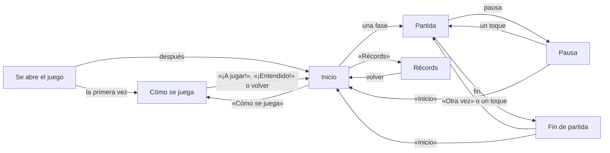

# Las pantallas

Cómo se va de una pantalla a otra (UI-01, UI-07, UI-20), como lo pidió Fangusk después de jugar la beta (2026-11-02,
[diseño](diseno.md)), y cómo se ven: con el arte de la interfaz de GameMaster (`arte/ui/`, [arte](arte.md#la-interfaz)),
según las maquetas que eligió Fangusk (`arte/ui/previas/`). Las medidas salen de las reglas del guion de las maquetas
(`diseno/ui/maquetas.py` del backlog), así que el juego las monta igual a cualquier tamaño de pantalla. Sin ese arte, el
juego se ve como el prototipo gris, con los mismos sitios.

## Lo común

- **El fondo de los menús**: el cielo de día, tres franjas de azul más claras hacia abajo, con las nubes del kit siempre en
  los mismos sitios de la pantalla.
- **Los botones pequeños** (volver, sonido, pausa): de 20 × 20, a 7 píxeles del borde de arriba y a 8 del de al lado, más
  la zona segura; así libran una esquina redondeada.
- **Pulsar**: un botón se ve pulsado mientras el dedo está encima y hace lo suyo al levantarlo, como piden las piezas
  pulsadas de GameMaster. Solo el salto va con el dedo al bajar.
- **Lo que queda centrado** se centra en la parte útil de la pantalla (sin márgenes ni zona segura) y, si no cabe en ella,
  en la pantalla.

## Inicio

El título (la variante B, «Asomados», con el gatito y el perrito asomados a las letras); una tarjeta por fase, Bosque,
Nieve y Desierto, con el nombre en su placa y una vista de su escenario que pasa despacio con Caro corriendo con su ropa;
debajo, «Récords» y «Cómo se juega» con sus iconos, y el botón de sonido a la derecha de la fila. Lo que sobra en vertical
se reparte en cuatro huecos iguales. Al tocar una fase empieza la partida en ella, ya corriendo, con el jingle de inicio.

## Partida

El marcador: los puntos a la izquierda (en rojo con 3 o menos) y, a la derecha, los metros, el botón de sonido y el de
pausa. En sus 3 primeras partidas, al llegar a cada uno de los 3 primeros barrancos sale sobre Caro, algo adelantada, la
pista: el dedo que mantiene, el medidor y «MANTÉN». Va con ella; si salta, sube con ella, y el medidor se llena con lo que
mantiene el salto (hasta los 0,36 s que da el salto más largo). Al aterrizar al otro lado, se va.

- **Pausa**: el panel de pausa y el botón «Inicio»; un toque en cualquier otro sitio, a seguir.
- **Fin de partida**: por qué acabó, la distancia contra el récord de la fase, los puntos máximos y, si la partida entra
  en las 5 mejores, «¡NUEVO RÉCORD!» (con Caro celebrándolo a los lados del panel) o su puesto. Debajo, «Otra vez» e
  «Inicio»; un toque en cualquier otro sitio, otra vez, como antes (UI-06). Durante 0,6 s no hace caso a los toques.

## Récords

Las pestañas de las fases sobre el panel, la elegida delante; y en el panel las 5 mejores partidas de la fase: el puesto
(medallas de oro, plata y bronce para las tres primeras), los metros (con punto de millar: 1.284), los puntos máximos de
esa partida y la fecha (2 NOV 2026). Las filas que faltan llevan su número y guiones; sin ninguna partida, «AÚN NO HAS
JUGADO AQUÍ». Los récords de las primeras versiones, solo la mejor distancia y los puntos, entran como una partida sin
fecha.

## Cómo se juega

Dos páginas con dos viñetas cada una. Cada viñeta es una partida en miniatura que se juega sola con la física de verdad,
con sus dos líneas debajo:

1. «TOCA PARA SALTAR · MANTÉN PARA SALTAR MÁS»: dos barrancos, uno corto y otro más ancho, con el dedo en la esquina:
   arriba mientras corre, tocando al saltar y manteniendo mientras dura el salto.
2. «RESCATA PERRITOS · Y GATITOS: +1»: cuatro animales y su «+1».
3. «EVITA EL HUEVO: -2 · Y EL PESCADO: -3»: los coge, para ver lo que quitan: el retroceso, el parpadeo y su «-2» y
   «-3».
4. «SE ACABA SI CAES · O SI LLEGAS A 0 PUNTOS»: cae por un barranco y vuelve a empezar; arriba, un 0 en rojo.

Arriba, volver (en la segunda página, a la primera), el título en la cinta y el botón para seguir: «Siguiente» y, en la
última página, «¡A jugar!» la primera vez y «¡Entendido!» desde el inicio. Un toque en cualquier otro sitio también sigue.
Debajo del panel, los puntos de página. Sale sola la primera vez que se abre el juego; después, desde «Cómo se juega».

## El sonido

El botón de sonido silencia la música y los efectos. Viene encendido la primera vez y el juego recuerda cómo lo dejó.

## El botón de atrás de Android

En una partida, la pausa; en «Cómo se juega», una página atrás; en cualquier otra pantalla, vuelve al inicio; en el
inicio, sale del juego.
