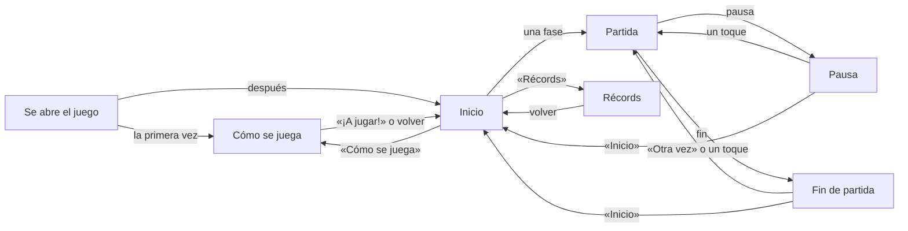

# Las pantallas

Cómo se va de una pantalla a otra (UI-01, UI-07, UI-20), como lo pidió Fangusk después de jugar la beta (2026-11-02,
[diseño](diseno.md)). Todo se dibuja con la fuente de píxeles del juego y, mientras no llegue el arte de la interfaz de
GameMaster (`arte/ui/`), con botones e iconos provisionales.

## Inicio

El título, CAROFARTY; una tarjeta por fase, Bosque, Nieve y Desierto, con una vista en movimiento de su escenario y Caro
esperando con su ropa, y la última que eligió, resaltada; los botones «Récords» y «Cómo se juega»; y el de sonido arriba a
la derecha. Al tocar una fase empieza la partida en ella, ya corriendo, con el jingle de inicio. Detrás, el escenario de
la última fase, quieto, y su música.

## Partida

El marcador: los puntos a la izquierda (en rojo con 3 o menos) y a la derecha la distancia, el botón de sonido y el de
pausa. En sus 3 primeras partidas, al acercarse a cada uno de los 3 primeros barrancos sale la pista «MANTÉN EL DEDO PARA
SALTAR MÁS» bajo el marcador.

- **Pausa**: el panel de pausa y el botón «Inicio»; un toque en cualquier otro sitio, a seguir.
- **Fin de partida**: por qué acabó, la distancia contra el récord de la fase, los puntos máximos y, si la partida entra
  en las 5 mejores, «¡NUEVO RÉCORD!» (con Caro celebrándolo a los lados) o su puesto. Debajo, «Otra vez» e «Inicio»; un
  toque en cualquier otro sitio, otra vez, como antes (UI-06). Durante 0,6 s no hace caso a los toques.

## Récords

Una pestaña por fase y sus 5 mejores partidas: el puesto, los metros, los puntos máximos de esa partida y la fecha. La
primera, resaltada. Los récords de las primeras versiones, solo la mejor distancia y los puntos, entran como una partida
sin fecha.

## Cómo se juega

Cuatro páginas, cada una con una partida en miniatura que se juega sola con la física de verdad, sus dos líneas y los
botones «Atrás» y «Siguiente» (en la última, «¡A jugar!»):

1. «TOCA PARA SALTAR · MANTÉN EL DEDO PARA SALTAR MÁS ALTO Y MÁS LEJOS»: dos barrancos, uno corto y otro más ancho, con el
   dedo en una esquina que se ve apretado mientras dura el salto.
2. «RESCATA PERRITOS Y GATITOS · CADA UNO SUMA 1 PUNTO»: cuatro animales y su «+1».
3. «EVITA EL HUEVO FRITO Y EL PESCADO · EL HUEVO RESTA 2 PUNTOS Y EL PESCADO 3»: los salta.
4. «LA PARTIDA SE ACABA SI CAES A UN BARRANCO · O SI TE QUEDAS SIN PUNTOS»: cae y vuelve a empezar.

Sale sola la primera vez que se abre el juego; después, desde «Cómo se juega».

## El sonido

El botón de sonido silencia la música y los efectos. Viene encendido la primera vez y el juego recuerda cómo lo dejó.

## El botón de atrás de Android

En una partida, la pausa; en cualquier otra pantalla, vuelve al inicio; en el inicio, sale del juego.
