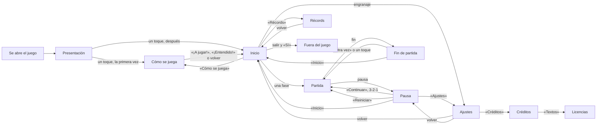

# Las pantallas

Cómo se va de una pantalla a otra (UI-01, UI-07, UI-20), como lo pidió Fangusk después de jugar la beta (2026-11-02,
[diseño](diseno.md)), y cómo se ven: con el arte de la interfaz de GameMaster (`arte/ui/`, [arte](arte.md#la-interfaz)),
según las maquetas que eligió Fangusk (`arte/ui/previas/`). Las medidas salen de las reglas del guion de las maquetas
(`diseno/ui/maquetas.py` del backlog), así que el juego las monta igual a cualquier tamaño de pantalla. Sin ese arte, el
juego se ve como el prototipo gris, con los mismos sitios.

## Lo común

- **El fondo de los menús**: el cielo de día, tres franjas de azul más claras hacia abajo, con las nubes del kit siempre en
  los mismos sitios de la pantalla; en la presentación, se mueven.
- **Los botones pequeños** (volver, sonido, pausa): de 20 × 20, a 7 píxeles del borde de arriba y a 8 del de al lado, más
  la zona segura; así libran una esquina redondeada.
- **Del tamaño de un dedo** (ACC-03): cada botón cuenta 4 píxeles de más alrededor para el dedo, así que hasta el más
  pequeño mide al menos 48 dp en Android y 44 pt en iOS: 68 dp en el Nothing de Fangusk y 56 pt en un iPhone SE. Lo que
  va pegado a otra cosa cuenta lo que tiene libre: los botones de la pausa, la mitad del hueco de arriba y de abajo; las
  filas de los ajustes y cada mitad de su «SÍ | NO», 26 px sin más; las pestañas de los récords, 4 px arriba y abajo
  (GameMaster). Lo comprueba `TouchTargetsTest` en seis pantallas.
- **Pulsar**: un botón se ve pulsado mientras el dedo está encima y hace lo suyo al levantarlo, como piden las piezas
  pulsadas de GameMaster. Solo el salto va con el dedo al bajar.
- **Lo que queda centrado** se centra en la parte útil de la pantalla (sin márgenes ni zona segura) y, si no cabe en ella,
  en la pantalla.

## Presentación

Lo primero al abrir el juego, el título animado que eligió Fangusk (UI-07), como lo describió GameMaster:

- **Arriba**, el título en el mismo sitio que en el inicio, sobre el cielo de los menús con sus nubes moviéndose despacio
  hacia la izquierda (las pequeñas, más despacio, como más lejos). Debajo, a 4 px, el subtítulo que eligió Fangusk,
  «SALVANDO EL MUNDO, PATITA A PATITA», en la cinta del kit (en crema con su sombra).
- **En medio**, «TOCA PARA EMPEZAR» en letras dobles, en frambuesa con un contorno de 1 px, como eligió Fangusk,
  parpadeando (0,8 s sí y 0,4 s no).
- **Abajo**, de lado a lado, el escenario de la última fase jugada: su cielo, sus fondos con su parallax y su suelo pasan
  a 60 px/s, el paso de las tarjetas, con Caro corriendo a un cuarto de la pantalla con su ropa de esa fase. La junta entre
  los dos cielos la tapa el banco de nubes de GameMaster, repetido de lado a lado y moviéndose a la izquierda a 5 px/s: el
  escenario se ve por debajo de una capa de nubes. Empieza bajo la segunda franja del cielo o, en una pantalla baja, lo
  justo para que las nubes no toquen «TOCA PARA EMPEZAR».
- **Animales**: cada 5 s Caro alcanza a uno, por turnos un gatito sentado y un perrito que pasea hacia donde ella corre,
  más despacio. Los rescata como en una partida: el animal se va, a ella se le pone la cara contenta un momento y sube su
  «+1», que se para antes de llegar al texto. Fue idea del agente, para que no los atraviese sin más; GameMaster se lo
  consulta a Fangusk.
- **Música**: suena el bucle de la última fase jugada, el mismo que sigue en el inicio.

Un toque en cualquier sitio suena a «ui-pulsar» y pasa, sin transición, a «Cómo se juega» la primera vez y al inicio
después: el título se queda en su sitio, la cinta y el texto se van y aparecen las tarjetas. Al volver de una partida se
va al inicio, nunca a la presentación. Todo lo que pasa en ella sale del tiempo, así que no guarda nada ni cuesta nada
mantenerla.

## Inicio

El título (la variante B, «Asomados», con el gatito y el perrito asomados a las letras); una tarjeta por fase, Bosque,
Nieve y Desierto, con el nombre en su placa y una vista de su escenario que pasa despacio con Caro corriendo con su ropa,
y la última que jugó en un marco dorado (Fangusk: «Sí, me parece buena idea»); debajo, «Récords» y «Cómo se juega» con
sus iconos, y a la derecha de la fila el engranaje de los ajustes y el botón de sonido, a 8 px para que sus zonas táctiles
no se pisen (GameMaster). Lo que sobra en vertical se reparte en cuatro huecos iguales. Al tocar una fase empieza la
partida en ella, ya corriendo, con el jingle de inicio.

Arriba a la izquierda, el botón de salir, con una puerta (Fangusk, tras la beta 4): pregunta «¿SALIR DEL JUEGO?» con «SÍ»
y «NO» en el panel del kit, sobre la pantalla oscurecida, y con «SÍ» cierra la app y la quita de las recientes. El botón
de atrás de Android, con la pregunta abierta, la cierra. En iOS no sale: Apple no deja que una app se cierre sola.

## Partida

El marcador: los puntos a la izquierda (en rojo con 3 o menos) y, a la derecha, los metros, el botón de sonido y el de
pausa. En sus 3 primeras partidas, al llegar a cada uno de los 3 primeros barrancos sale sobre Caro, algo adelantada, la
pista: el dedo que mantiene, el medidor y «MANTÉN». Va con ella; si salta, sube con ella, y el medidor se llena con lo que
mantiene el salto (hasta los 0,36 s que da el salto más largo). Al aterrizar al otro lado, se va.

- **Pausa** (UI-05), como la maqueta de GameMaster: la partida parada bajo un velo ciruela oscura al 59 % y, en medio, el
  panel con «PAUSA» en letras dobles y cuatro botones en columna, todos del ancho de «CONTINUAR», con el icono y la
  palabra a la izquierda: «Continuar», «Reiniciar» (otra partida en la misma fase, desde el principio), «Ajustes» e
  «Inicio». Un toque fuera del menú ya no sigue: solo «Continuar» o el botón de pausa del marcador, que sigue funcionando
  bajo el velo, como el de sonido. Al seguir, un respiro para el dedo: 3, 2 y 1 en grande sobre la partida sin velo,
  0,35 s cada uno (GameMaster lo sugirió y dejó el cómo al agente); el botón de pausa durante la cuenta vuelve al menú.
  Salir de la app o una llamada la pausan sola, también en mitad de la cuenta, y el botón atrás del teléfono también; en
  la pausa, el botón atrás sigue la partida.
- **Fin de partida**: un título con gracia según cómo acabó, que eligió Fangusk tras la beta 8: «¡UPS! ¡AL AGUA!» al caer
  a un barranco del Bosque o la Nieve, «¡UPS! ¡AL CAÑÓN!» en el Desierto, «¡PUAJ! DEMASIADO MAL OLOR» sin puntos y, si
  los últimos se los quitó un pájaro, «¡AY! ¡QUÉ PICOTAZO!» (idea de GameMaster). Debajo, los animales salvados en la
  partida, que enlazan con el subtítulo: «HAS SALVADO 23 ANIMALITOS», «HAS SALVADO 1 ANIMALITO» o, sin ninguno, «¡LOS
  ANIMALITOS TE ESPERAN!» (UI-24). Después, la distancia contra el récord de la fase (con punto de millar, como en los
  récords), los puntos máximos y, si la partida entra en las 5 mejores, su puesto. Debajo, «Otra vez» e «Inicio», con sus
  iconos; un toque en cualquier otro sitio, otra vez, como antes (UI-06). Durante 0,6 s no hace caso a los toques.
- **Récord nuevo** (UI-15, Fangusk: «ok», con contador y confeti pixel; la maqueta de GameMaster): bajo el título y los
  animales, «¡NUEVO RÉCORD!» en oro y en letras dobles y, debajo, sus metros en grande en lugar de la línea de la
  distancia, que diría dos veces lo mismo. La cifra sube de 0 a los metros en 1 s, deprisa y frenando al final
  (`final·(1−(1−t)³)`), en crema; al llegar se pone en oro y bota 2 px durante 120 ms. Entonces cae el confeti, una sola
  vez y por delante de todo: 60 papelitos de golpe y 20 por segundo durante 2 s por cada 400 px de ancho, de los cinco
  colores y en 2 × 2 o 2 × 3, que nacen justo encima de la pantalla bajando deprisa, el aire los frena hasta que flotan,
  se mecen y giran, y se van por abajo: unos 5,5 s. Caro lo celebra a los dos lados del panel.

## Récords

Las pestañas de las fases sobre el panel, la elegida delante; y en el panel las 5 mejores partidas de la fase: el puesto
(medallas de oro, plata y bronce para las tres primeras), los metros (con punto de millar: 1.284), los puntos máximos de
esa partida y la fecha (2 NOV 2026). Las filas que faltan llevan su número y guiones; sin ninguna partida, «AÚN NO HAS
JUGADO AQUÍ». Los récords de las primeras versiones, solo la mejor distancia y los puntos, entran como una partida sin
fecha.

## Cómo se juega

Dos páginas con dos viñetas cada una. Cada viñeta es una partida en miniatura que se juega sola con la física de verdad,
con sus dos líneas debajo:

1. «TOCA PARA SALTAR · MANTÉN PARA SALTAR MÁS»: dos barrancos, uno corto y otro más ancho, con el dedo en la esquina:
   arriba mientras corre, tocando al saltar y manteniendo mientras dura el salto.
2. «RESCATA PERRITOS · Y GATITOS: +1»: cuatro animales y su «+1».
3. «EVITA EL HUEVO: -3 · Y EL PESCADO: -5»: los coge, para ver lo que quitan: el retroceso, el parpadeo y su «-3» y
   «-5». Las viñetas empiezan con puntos de sobra, así que nunca se acaban por eso.
4. «SE ACABA SI CAES · O SI LLEGAS A 0 PUNTOS»: cae por un barranco y vuelve a empezar; arriba, un 0 en rojo.

Arriba, volver (en la segunda página, a la primera), el título en la cinta y el botón para seguir: «Siguiente» y, en la
última página, «¡A jugar!» la primera vez y «¡Entendido!» desde el inicio. Un toque en cualquier otro sitio también sigue.
Debajo del panel, los puntos de página. Sale sola la primera vez, tras la presentación; después, desde «Cómo se juega».

## Ajustes

Desde el engranaje del inicio, sobre el cielo de los menús, o desde «Ajustes» de la pausa, sobre la partida parada con su
velo; volver lleva a donde se vino. Es la propuesta A de GameMaster (UI-11, TEC-09; Fangusk: «Me parece bien»): volver y
la cinta arriba, como los récords, y un panel con una fila por ajuste, alternas en ciruela clara como la tabla de los
récords, cada una con su icono, su nombre y un «SÍ | NO» hecho con las pestañas del kit en una ranura: la elegida
levantada en frambuesa y la otra en ciruela, 2 px más baja.

- **Música** y **Efectos**, cada uno por su lado; el botón de sonido sigue apagándolo todo de golpe. Con él apagado, las
  dos filas se ven atenuadas sin perder su valor (GameMaster) y no hacen caso a los toques hasta que vuelva el sonido
  (decisión del agente: atenuadas quiere decir que ahora no cuentan).
- **Vibración**: una vibración suave solo con lo malo, al coger un huevo, un pescado o un pájaro y al caer; ni al
  rescatar ni al aterrizar (Fangusk). Es la de «rechazo» del teléfono, que también sigue sus ajustes de vibración al tocar.
- **Al cambiar algo**: cada mitad elige lo suyo y el resto de la fila cambia de una a otra. La música se para o sigue en el
  momento, los efectos suenan con el toque que los enciende y la vibración, al encenderla, vibra una vez para que se note.
  Todo viene encendido la primera vez y el juego lo recuerda.

Debajo del panel, «Créditos».

## Créditos y licencias

Los créditos (UI-16), con volver y la cinta como los ajustes: en el panel, «A FANGUSK.DEV GAME» en letras dobles, tal cual
y en inglés (Fangusk), un hilo en ciruela clara y, debajo, «LICENCIAS» y las librerías del juego con su licencia (LEG-05,
[licencias](licencias.md)): la librería en crema y la licencia en frambuesa luz. Sin dedicatoria (UI-23).

Arriba a la derecha, «Textos» lleva a los textos enteros de las licencias, para leerlos sin internet: la lista de las
librerías, la Apache 2.0 y el aviso de Skia, cada uno desde una página nueva y en mayúsculas, como los dibuja la fuente
del juego. Van por páginas (una treintena en el Nothing), con «3 DE 28» al pie; «Siguiente» o un toque en la página pasa a
la siguiente y volver, a la anterior, y desde la primera a los créditos.

## El sonido

El botón de sonido silencia la música y los efectos. Viene encendido la primera vez y el juego recuerda cómo lo dejó. La
música y los efectos, cada uno por su lado, en los ajustes.

## El botón de atrás de Android

En una partida, la pausa, y en la pausa, sigue la partida (con su cuenta); en los ajustes, los créditos y las licencias,
un paso atrás; en «Cómo se juega», una página atrás; en los récords, vuelve al inicio; en el inicio y en la presentación,
sale del juego.
